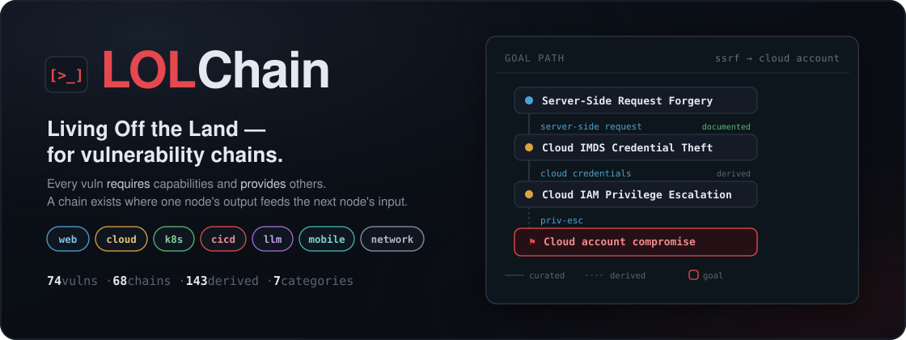
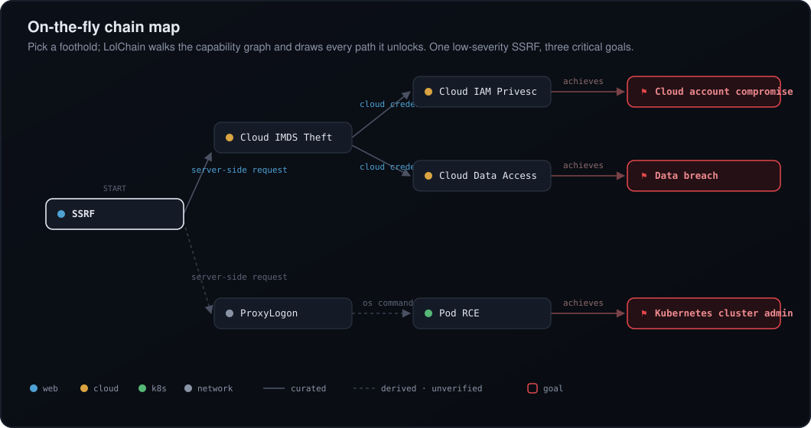
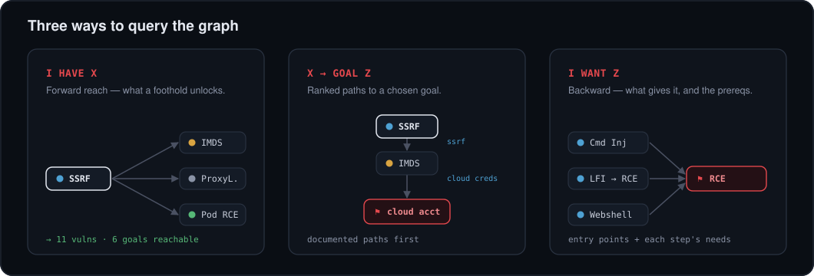

<p align="center">
  
</p>

<p align="center">
  <b><a href="https://naturalstate.github.io/LOLChain/">🔗 Live site</a></b>
  &nbsp;·&nbsp; 47 vulns &nbsp;·&nbsp; 29 curated chains &nbsp;·&nbsp; 29 derived candidates &nbsp;·&nbsp; 7 categories
</p>

---

> **Authorized use only.** LolChain is a *conceptual* reference for pentesters, red
> teams, and defenders. Entries describe how one weakness hands capabilities to the
> next — the handoff, its outcome, detection, and remediation — **not** copy-paste
> exploit code. Use the ideas only against systems you are authorized to test. See
> [Scope &amp; ethics](https://naturalstate.github.io/LOLChain/scope/).

## What is LolChain?

The "Living Off the Land" reference sites — [GTFOBins](https://gtfobins.github.io),
[LOLBAS](https://lolbas-project.github.io), [lolcreds](https://lolcreds.haxx.it) — each
catalog **single primitives**: here's a binary, here's what it can do. They're lookup
tables.

Real breaches aren't single primitives. They're **chains** — a "boring" SSRF becomes
cloud credentials becomes an IAM-admin role becomes a data breach. LolChain catalogs the
*chains*, and makes them queryable.

The trick is a **precondition / postcondition data model**. Every vuln is a handoff:

- it **`requires`** some capabilities (what you need before it's reachable), and
- it **`provides`** others (what you hold afterward), and
- it may **`achieve`** a goal (a critical end state).

An edge exists wherever one node's `provides` satisfies another node's `requires`. That
single rule turns a flat list into a graph you can walk — forward, toward a goal, or
backward — and lets a new vuln slot in by capability tag instead of a hand-wired page.

## The on-the-fly chain map

Pick a foothold and LolChain walks the capability graph, drawing every path it unlocks —
rendered live in the browser. One low-severity SSRF, three critical goals:

<p align="center">
  
</p>

Nodes are colored by category; **solid edges are curated** (human-authored, cited),
**dashed edges are derived** (inferred from capability overlap — plausible, unverified);
**red-bordered nodes are goals**. Every edge is labeled with the capability that links
the two steps.

## Three ways to query

<p align="center">
  
</p>

| Mode | Question | What it returns |
|---|---|---|
| **I have X** | "I've got a foothold on X (or hold capability C) — now what?" | Forward reachability: every vuln those capabilities unlock, **hop by hop**, with the linking capability and the goals reached. |
| **X → goal Z** | "From X, how do I reach goal Z?" (optionally **through** node Y) | **Ranked paths** — documented first, then fully-curated, then shorter, then easier. |
| **I want Z** | "I want to achieve Z — what gives it?" | Backward search: every vuln that **achieves** Z and the entry paths that reach each one. |

All three run **client-side** over a single `graph.json` — no backend, no telemetry.

## Types of chains

Chains are tiered by sophistication, and every edge is one of two kinds:

- **Curated** — human-authored, with an outcome, a difficulty, and references. Shown
  first and marked *documented*.
- **Derived** — inferred by the build wherever capabilities line up and no curated edge
  exists. Shown as *derived · unverified*: a plausible handoff to investigate.

| Tier | What it covers | Example |
|---|---|---|
| **basic** | Classic 2-link handoffs | Reflected XSS → session hijack → account takeover |
| **advanced** | Harder primitives &amp; 3-link chains | Insecure deserialization → RCE; XXE → SSRF → internal service |
| **expert** | Full kill-chain archetypes | ProxyLogon, ProxyShell, browser full-chain, low-and-slow → Domain Admin |

## Categories &amp; example chains

LolChain spans **7 categories**. One representative chain from each (`A —[capability]→ B`):

### 🔵 web
The classic surface — injection, auth, and client-side flaws.
```
Reflected XSS —[read-session-token]→ Session Hijack  ⇒  account takeover
SQL Injection —[arbitrary-file-write]→ Webshell       ⇒  remote code execution
```

### 🟡 cloud
Where a web-tier bug becomes an identity breach.
```
SSRF —[server-side-request]→ Cloud IMDS Theft —[cloud-credentials]→ IAM Privilege Escalation  ⇒  cloud account compromise
```

### 🟢 kubernetes
Container foothold to cluster takeover.
```
Pod RCE —[service-account-token]→ SA RBAC Abuse —[cluster-api-access]→ Privileged Pod Escape —[node-root]→ Node to Cluster Admin  ⇒  cluster admin
```

### 🔴 cicd
Poison the pipeline, poison everyone downstream.
```
Poisoned Pipeline Execution —[ci-secrets]→ Pipeline Secret Exfil —[supply-chain-write]→ Backdoored Artifact  ⇒  supply-chain compromise
```

### 🟣 llm
Prompt injection is the SSRF of the AI stack.
```
Indirect Prompt Injection —[llm-tool-access]→ Agent Tool Abuse —[server-side-request]→ Cloud IMDS Theft  ⇒  cloud account compromise
```

### 🟦 mobile
Thick clients leak keys; APIs leak everyone's data.
```
Hardcoded Key in Binary —[api-credentials]→ API BOLA  ⇒  data breach
Deep-Link OAuth Theft —[token-leak]→ OAuth Token Theft  ⇒  account takeover
```

### ⬜ network
Enterprise and infrastructure kill-chains.
```
ProxyLogon (pre-auth SSRF) —[arbitrary-file-write]→ Webshell  ⇒  remote code execution
Low-and-Slow Enterprise —[domain-credentials]→ AD Domain Takeover  ⇒  domain admin
```

## The vocabulary

Two small controlled vocabularies are the glue of the whole graph:

- **Capabilities** (`data/capabilities.yml`) — the *handoff currency*. Grouped into entry
  conditions, access &amp; execution, data &amp; secrets, and reach &amp; movement. Examples:
  `server-side-request`, `os-command-exec`, `cloud-credentials`, `service-account-token`,
  `read-session-token`, `arbitrary-file-write`.
- **Goals** (`data/goals.yml`) — the controlled vocabulary of **end states**:
  `account-takeover`, `remote-code-execution`, `cloud-account-compromise`, `data-breach`,
  `privilege-escalation`, `auth-bypass`, `internal-network-access`, `cluster-admin`,
  `domain-admin`, `supply-chain-compromise`.

Keeping these curated and small is what makes goal-directed search reliable and lets
derived edges fall out automatically.

## Site features

- **Catalog** with a faceted filter rail (Tier · Category · Provides capability), live
  text search, and a running count — lolcreds-style.
- **Per-node pages** (`/node/<slug>/`) with the full capability handoff (requires /
  provides / achieves), the chains out of the node, what reaches it, and a **defense
  panel**: detection, remediation, and MITRE ATT&amp;CK mappings.
- **Query engine** — the three modes above, over `graph.json`, client-side.
- **Interactive graph view** — every query result is also rendered as a pannable,
  zoomable node/edge graph (Cytoscape).
- **Derived candidate chains** — surfaced everywhere, always marked *unverified*.
- **Defensive parity** — every node carries detection + remediation, so the same graph
  that shows an attack path shows defenders which link to break.
- **Scope/ethics + about pages**, and a **CI validation gate** on every PR.

## Tech stack

- **Data** — YAML in `data/`, hand-edited and PR-reviewed.
- **Schema** — JSON Schema (`schema/node.schema.json`), draft-07.
- **Build** — a Node script (`scripts/build.mjs`) loads + validates the YAML, resolves
  curated and derived edges, and emits `public/graph.json`. Core logic lives in
  `src/lib/graph.mjs`, shared with the site.
- **Frontend** — [Astro](https://astro.build): static per-node pages + client-side query
  islands. Pathfinding runs in the browser; no backend.
- **Hosting** — GitHub Pages, auto-deployed by GitHub Actions on every push to `main`.

## Run it locally

```bash
npm install
npm run data      # validate dataset -> public/graph.json
npm run dev       # data + astro dev server (http://localhost:4321/LOLChain/)
npm run build     # data + static site -> dist/
npm run validate  # schema + cross-reference check only (the CI gate)
```

## Add a vuln

1. Create `data/nodes/<slug>.yml` (filename must match `slug`).
2. Reference only capability slugs from `capabilities.yml` in `requires` / `provides` /
   chain `via`, and goal slugs from `goals.yml` in `achieves`.
3. Add curated `chains:` with `to:` (an existing node), `via:`, `outcome:`, and real
   `references:`. **Never invent references.**
4. `npm run validate` — the build fails loudly on unknown slugs, bad targets, or a chain
   whose `via` isn't a subset of the node's `provides`.

See **[CONTRIBUTING.md](CONTRIBUTING.md)** for the full schema and rules.

## Repo layout

```
data/
  capabilities.yml        # handoff-currency vocabulary
  goals.yml               # controlled end-state vocabulary
  nodes/<slug>.yml        # one vuln per file
schema/node.schema.json   # validation
scripts/build.mjs         # YAML -> validate -> graph.json
src/
  lib/graph.mjs           # load + validate + resolve edges (shared)
  lib/query.mjs           # forward reachability engine
  lib/path.mjs            # goal-directed + backward pathfinding
  pages/                  # index, node/[slug], query, scope, about, 404
docs/images/              # README graphics
.github/workflows/        # validate (CI gate) + deploy (Pages)
```

## Status

- [x] **Phase 0** — pipeline skeleton (schema, vocab, seed nodes, build, filterable UI).
- [x] **Phase 1** — dataset (47 vulns, 29 curated chains, 7 categories).
- [x] **Phase 2** — "I have X" forward query + facets + per-node pages.
- [x] **Phase 3** — goal-directed + constrained + backward pathfinding; derived chains.
- [x] **Phase 4** — interactive graph visualization (Cytoscape).
- [x] **Phase 5** — scope/ethics + about pages, CONTRIBUTING, CI validation gate.
- [ ] **Phase 6** — enrichment: ingest public writeups as *proposed* YAML for human review.

## License &amp; attribution

Curated chains cite their sources (PortSwigger, OWASP, vendor advisories, public
research). References are never invented. A chain dies at its weakest link — so does an
attack. Build accordingly.
